# LabLoan

**Sistem Peminjaman Alat & Ruang Laboratorium berbasis web**
Tugas Besar Praktikum Pemrograman Web 2026 · Kelompok 07

- **Repository:** https://github.com/georguess/TUBES_PRK_PEMWEB_2026 (folder `kelompok/kelompok_07/`)
- **Tema Fakultas:** TEKNIK

LabLoan membantu mahasiswa mengajukan peminjaman alat dan ruang laboratorium secara online, memantau status pengajuan, serta membantu admin laboratorium memproses persetujuan, pengembalian, dan laporan secara rapi dan tercatat.

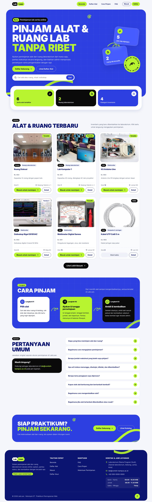

---

## Daftar Isi

1. [Anggota Kelompok](#anggota-kelompok)
2. [Fitur](#fitur)
3. [Teknologi](#teknologi)
4. [Struktur Folder](#struktur-folder)
5. [Database & ERD](#database--erd)
6. [Instalasi](#instalasi)
7. [Akun Default](#akun-default)
8. [Panduan Penggunaan](#panduan-penggunaan)
9. [Aturan Sistem](#aturan-sistem)
10. [Screenshot](#screenshot)
11. [Konfigurasi](#konfigurasi)

---

## Anggota Kelompok

| No | Nama | NPM | Tugas |
|----|------|-----|-------|
| 1 | Muhammad Fadhel Saputra | 2415061097 | Fondasi project, database, layout, redesain UI |
| 2 | Nabilah Putri Tarevi | 2415061025 | Auth & session |
| 3 | Mohammad Nabil Pasha	| 2415061069 | CRUD kategori & alat |
| 4 | Aldo Riyantama | 2415061068 | Peminjaman (katalog, ajuan, riwayat, detail alat) |
| 5 | Fathan Rizqi Syahbana | 2415061022 | Admin (approval, pengembalian, dashboard, laporan) |

---

## Fitur

### Pengunjung (belum login)
- Beranda dengan ringkasan inventaris, alat & ruang terbaru, cara pinjam, dan FAQ
- Daftar alat & ruang dengan pencarian (nama, kode, lokasi, deskripsi) dan filter kategori, jenis, ketersediaan
- Halaman detail alat (lokasi, kondisi, stok, deskripsi)
- Registrasi akun peminjam dan login

### Peminjam
- Katalog peminjaman dengan pencarian langsung (live search) dan filter
- Formulir pengajuan: tanggal pinjam, tanggal kembali, jumlah, keperluan
- Riwayat peminjaman beserta keterangan arti setiap status

### Admin
- Dashboard: total stok, pengajuan menunggu, peminjaman aktif, laporan periode berjalan
- Persetujuan dan penolakan pengajuan, pencatatan pengembalian (stok otomatis diperbarui)
- Kelola kategori (CRUD)
- Kelola data alat & ruang (CRUD + upload foto JPG/PNG/WEBP maks. 2 MB)
- Laporan peminjaman per periode, dapat dicetak atau disimpan sebagai PDF

### Umum
- Tampilan responsif mulai lebar layar 360px
- Aksesibilitas: skip link, focus ring, `alt` dan `aria-label`, animasi mati jika `prefers-reduced-motion`

---

## Teknologi

| Bagian | Teknologi |
|--------|-----------|
| Backend | PHP 8.2 native, PDO dengan prepared statement |
| Database | MySQL / MariaDB (InnoDB, utf8mb4) |
| Frontend | HTML, CSS murni (`assets/css/style.css`), JavaScript vanilla (`assets/js/app.js`) |
| Font | Google Fonts: Archivo & Plus Jakarta Sans |
| Server lokal | Laragon (Apache + MySQL) |

Tidak ada library atau framework yang perlu diunduh manual.

---

## Struktur Folder

```
kelompok_07/
├── admin/
│   ├── alat/              CRUD alat & ruang (index, proses, functions)
│   ├── kategori/          CRUD kategori
│   ├── peminjaman/        Persetujuan & pengembalian
│   ├── dashboard.php      Dashboard admin
│   └── laporan.php        Laporan & cetak
├── alat/
│   ├── index.php          Daftar alat publik
│   └── detail.php         Detail alat
├── assets/
│   ├── css/style.css      Seluruh gaya tampilan
│   ├── js/app.js          Navbar mobile, live search, toggle password, cetak
│   └── img/
├── auth/                  login, register, logout
├── config/
│   ├── app.php            Konstanta aplikasi, kontak lab, helper (url, e, session)
│   └── koneksi.php        Koneksi PDO
├── database/
│   └── labloan.sql        Skema + data awal
├── docs/                  ERD & screenshot
├── includes/
│   ├── head.php, header.php, navbar.php, footer.php   Layout
│   ├── komponen.php       Kartu alat, badge status, ikon
│   ├── katalog.php        Query & filter katalog
│   ├── laporan.php        Query & tabel laporan (dipakai dashboard & laporan)
│   ├── dekorasi.php       Elemen dekoratif SVG
│   └── *_check.php        Proteksi halaman per role
├── peminjaman/            katalog, ajukan, proses_ajukan, riwayat
├── uploads/alat/          Foto alat
└── index.php              Beranda
```

---

## Database & ERD


| Tabel | Fungsi |
|-------|--------|
| `users` | Akun admin dan peminjam (`role`: admin / peminjam) |
| `kategori` | Pengelompokan alat & ruang |
| `alat` | Data alat dan ruang (`jenis`: alat / ruang), stok, lokasi, kondisi, foto |
| `peminjaman` | Header pengajuan: peminjam, jadwal, keperluan, status, admin yang memproses |
| `detail_peminjaman` | Alat dan jumlah dalam satu pengajuan |

**Relasi:**
- `kategori` 1 : N `alat`
- `users` 1 : N `peminjaman` (sebagai peminjam, `user_id`)
- `users` 1 : N `peminjaman` (sebagai admin pemroses, `diproses_oleh`, boleh kosong)
- `peminjaman` 1 : N `detail_peminjaman` (hapus berantai)
- `alat` 1 : N `detail_peminjaman`

**Alur status peminjaman:**

```
menunggu ──(admin setujui)──▶ disetujui ──(admin proses kembali)──▶ dikembalikan
    │
    ├──(admin tolak)──────────▶ ditolak
    └──(lebih dari 3 hari)────▶ ditolak (otomatis)
```

File skema: [`database/labloan.sql`](database/labloan.sql)

---

## Instalasi

**Kebutuhan:** Laragon (atau XAMPP) dengan PHP 8.2+ dan MySQL/MariaDB.

1. **Ambil source code**
   ```bash
   git clone https://github.com/georguess/TUBES_PRK_PEMWEB_2026.git
   ```
   Letakkan di dalam `C:\laragon\www\` (folder project ada di `TUBES_PRK_PEMWEB_2026\kelompok\kelompok_07\`).

2. **Jalankan Laragon**, lalu klik **Start All**.

3. **Buat database dan import skema**
   - Buka HeidiSQL (tombol **Database** di Laragon) atau phpMyAdmin.
   - Buat database baru bernama `labloan` (collation `utf8mb4_unicode_ci`).
   - Pilih database `labloan`, lalu jalankan file `database/labloan.sql`.
   - Lewat terminal Laragon:
     ```bash
     mysql -u root -e "CREATE DATABASE labloan CHARACTER SET utf8mb4 COLLATE utf8mb4_unicode_ci"
     mysql -u root labloan < database/labloan.sql
     ```

4. **Cek koneksi** di `config/koneksi.php`. Default Laragon sudah sesuai (host `localhost`, user `root`, password kosong).

5. **Buka di browser:**
   ```
   http://localhost/TUBES_PRK_PEMWEB_2026/kelompok/kelompok_07/
   ```
   Sesuaikan dengan lokasi folder di `www`. Base URL terdeteksi otomatis.

---

## Akun Default

| Role | Email | Password |
|------|-------|----------|
| Admin | `admin@labloan.test` | `admin123` |
| Peminjam | Daftar sendiri lewat menu **Daftar** | minimal 8 karakter |

Segera ganti password admin setelah instalasi pada server sungguhan.

---

## Panduan Penggunaan

### Sebagai Peminjam
1. Klik **Daftar**, isi nama, email, NIM/NIP, nomor HP, dan password, lalu **Masuk**.
2. Buka **Ajukan Peminjaman**. Cari alat dengan kolom pencarian atau filter, lalu klik kartu alat yang stoknya tersedia.
3. Isi **tanggal pinjam**, **tanggal kembali**, **jumlah**, dan **keperluan**, lalu klik **Ajukan Peminjaman**.
4. Pantau status di menu **Riwayat**:
   - **Menunggu**: belum diproses admin
   - **Disetujui**: alat boleh diambil sesuai jadwal
   - **Ditolak**: pengajuan tidak dapat dipenuhi
   - **Dikembalikan**: transaksi selesai
5. Ambil alat sesuai jadwal dan kembalikan sebelum batas kembali.

### Sebagai Admin
1. Masuk dengan akun admin, otomatis ke **Dashboard**.
2. **Kategori**: tambah, ubah, atau hapus kategori (kategori yang masih dipakai alat tidak bisa dihapus).
3. **Data Alat**: tambah atau ubah alat/ruang beserta foto, stok, lokasi, dan kondisi.
4. **Peminjaman**: klik **Setujui** atau **Tolak** pada pengajuan menunggu; klik **Proses Kembali** saat alat dikembalikan.
5. **Laporan**: pilih rentang tanggal, klik **Filter**, lalu **Cetak / Simpan PDF**. Hasil cetak memuat judul laporan, periode, dan tanggal cetak.

---

## Aturan Sistem

- Tanggal pinjam paling cepat hari ini; tanggal kembali tidak boleh sebelum tanggal pinjam.
- Jumlah pinjam tidak boleh melebihi stok tersedia. Alat dengan stok 0 tidak bisa diajukan.
- Stok **berkurang saat admin menyetujui** pengajuan dan **bertambah saat admin mencatat pengembalian**.
- Pengajuan berstatus menunggu lebih dari 3 hari **ditolak otomatis** oleh sistem.
- Semua query memakai prepared statement, semua output memakai `e()` (escape HTML), dan aksi persetujuan serta pengembalian dilindungi token CSRF.
- Halaman diproteksi per role (`includes/auth_check.php`, `admin_check.php`, `peminjam_check.php`).

---

## Screenshot

| | |
|---|---|
|  **Beranda** | 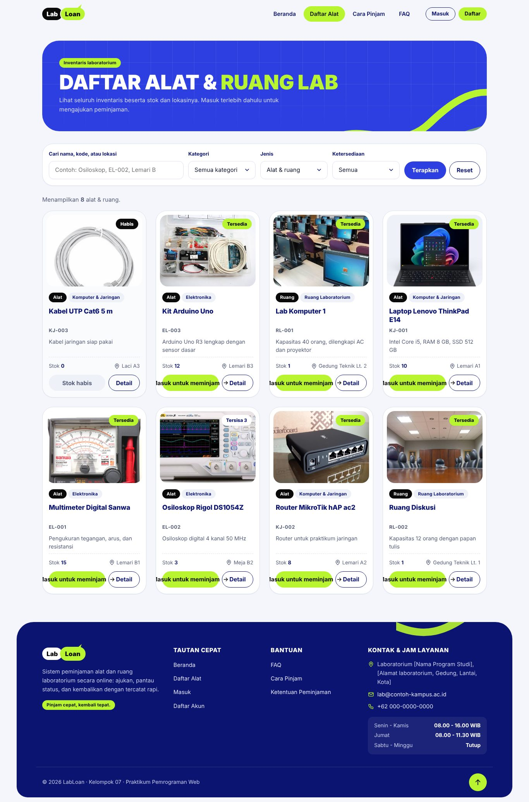 **Daftar alat & ruang** |
| 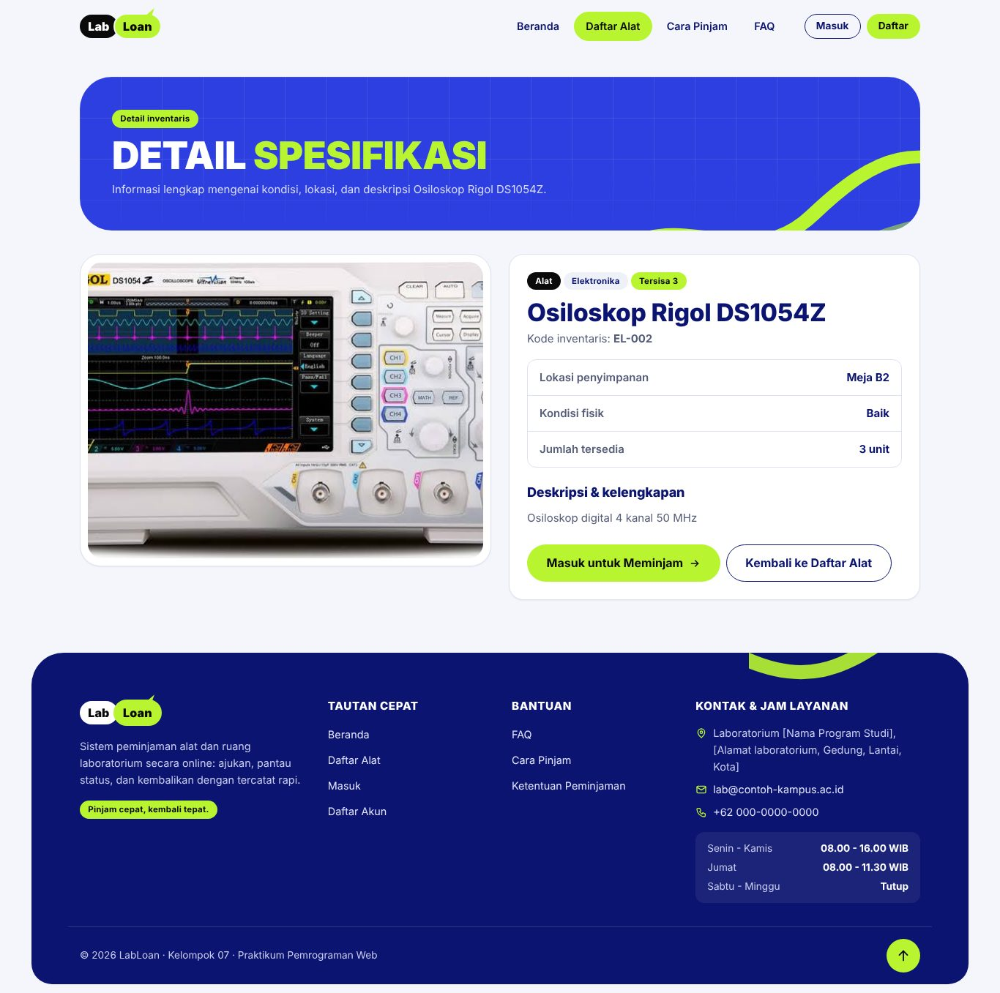 **Detail alat** | 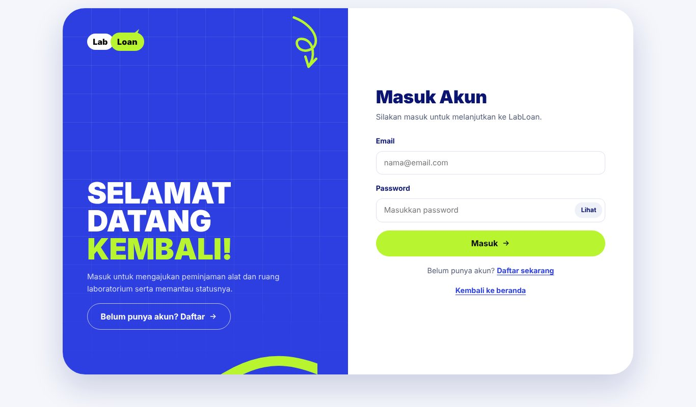 **Login** |
| 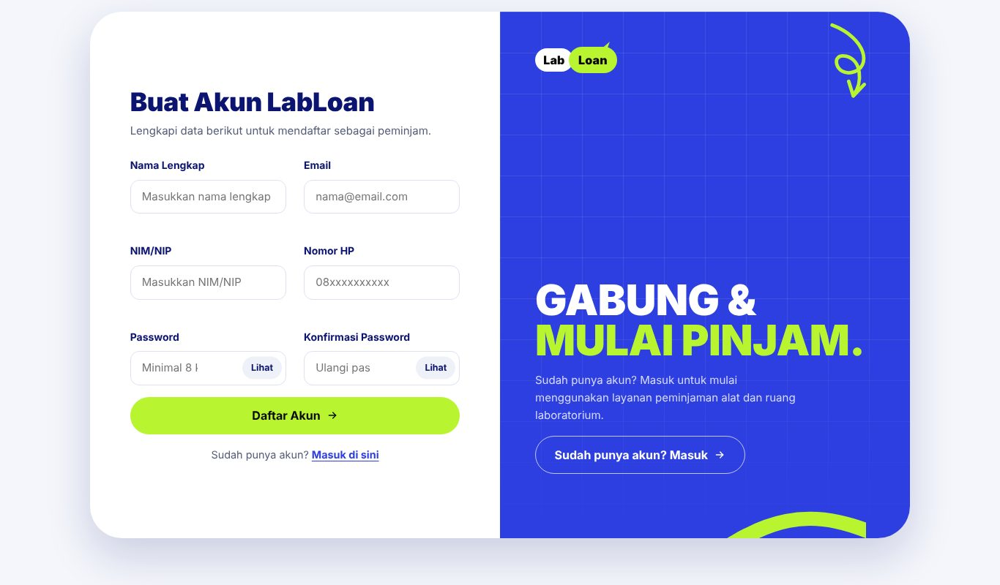 **Registrasi** | 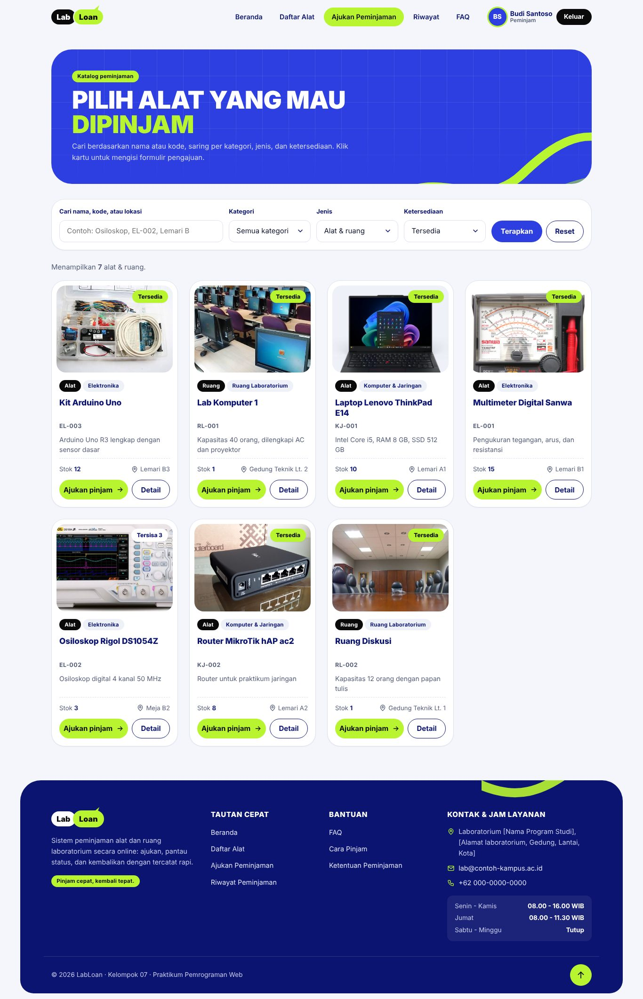 **Katalog peminjaman** |
| 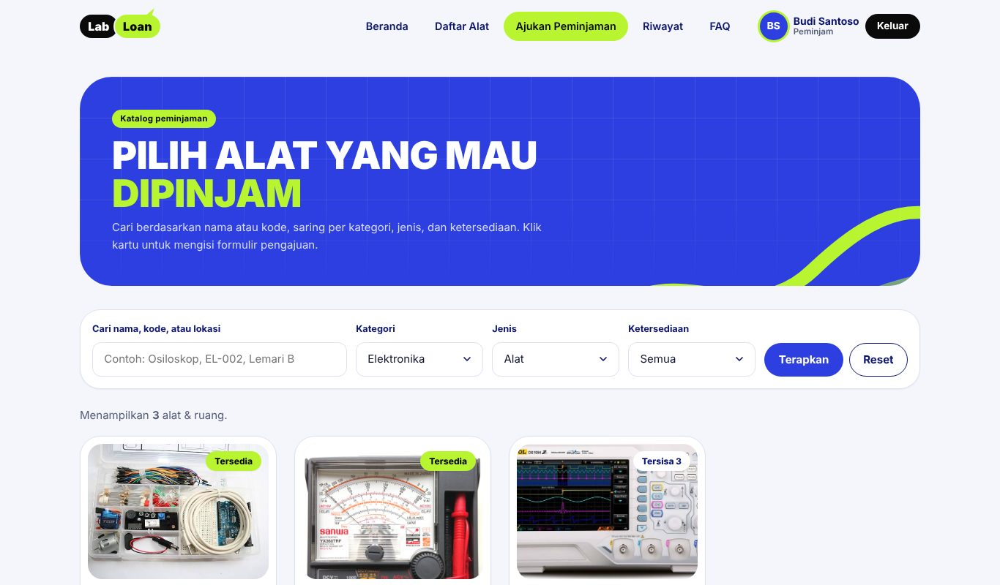 **Pencarian & filter** | 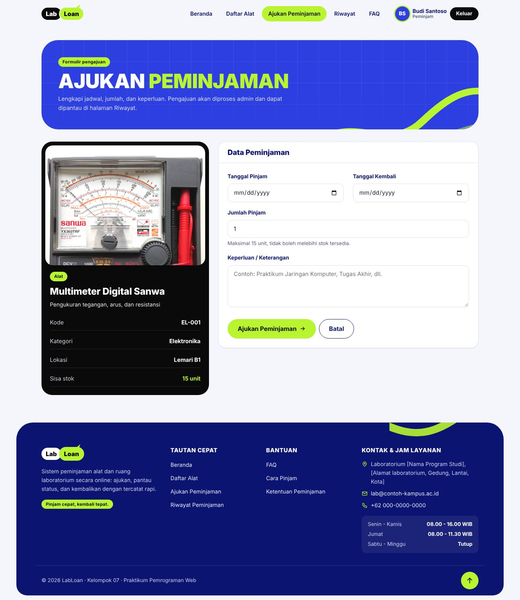 **Formulir pengajuan** |
| 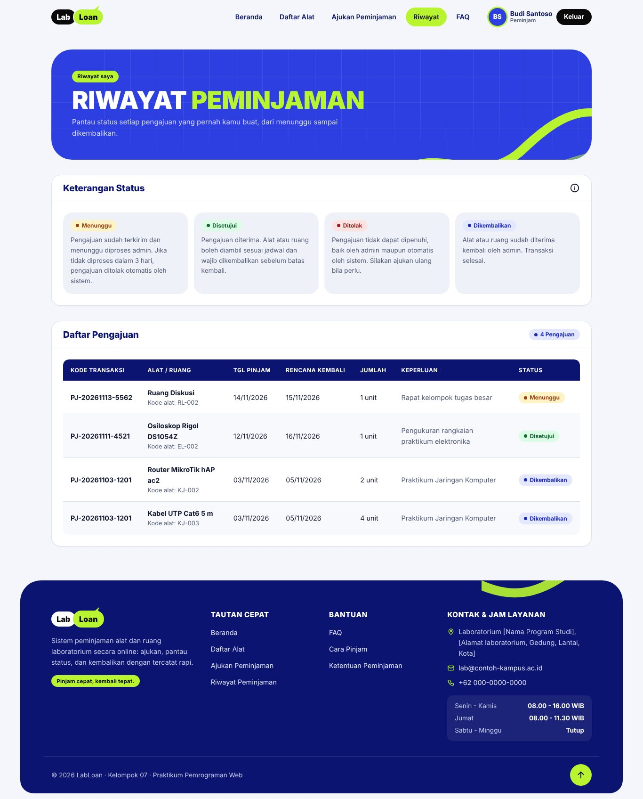 **Riwayat peminjaman** | 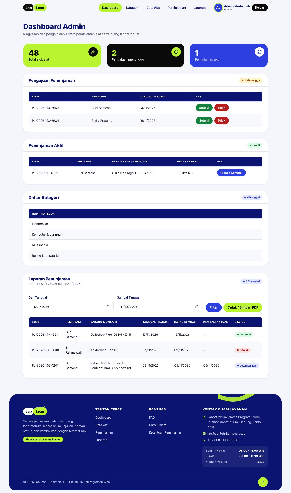 **Dashboard admin** |
| 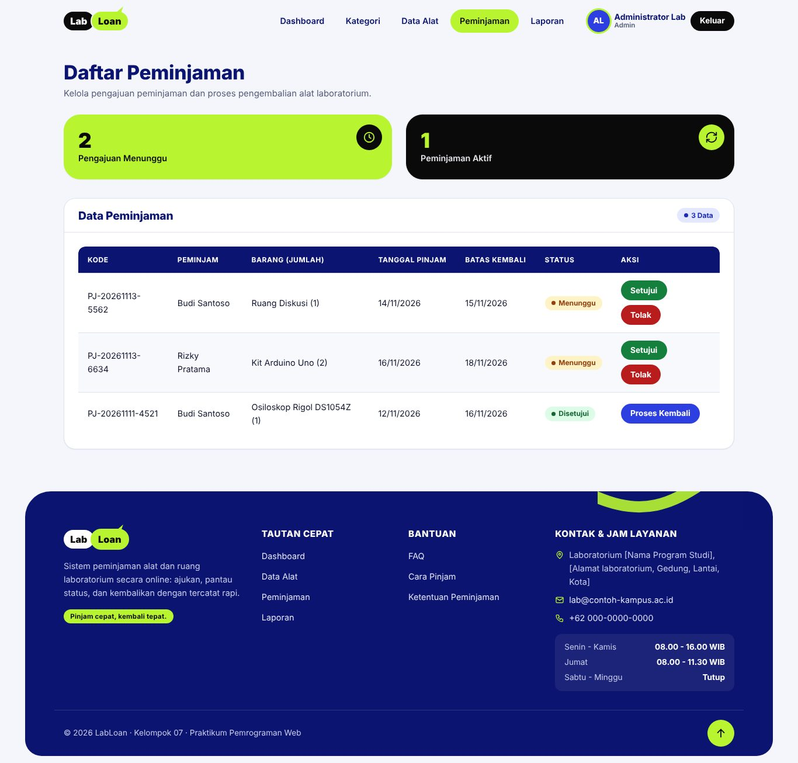 **Kelola peminjaman** | 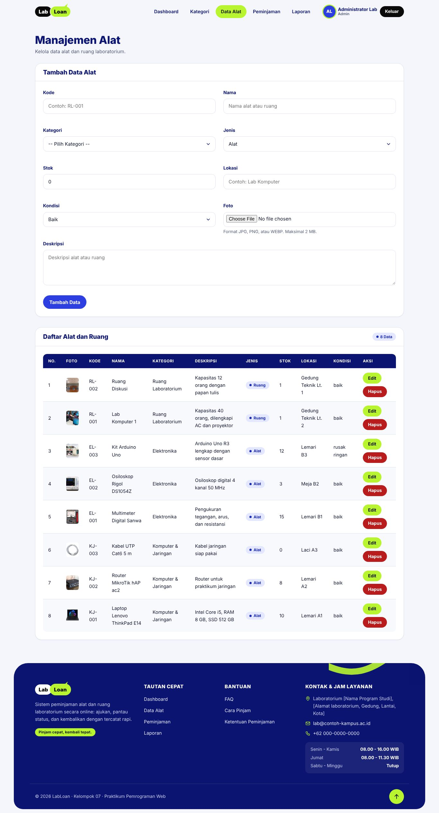 **Kelola alat** |
| 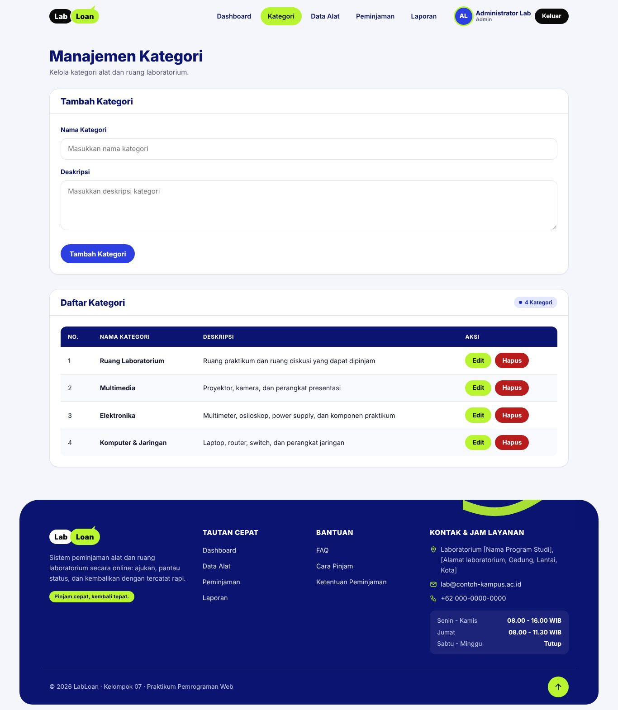 **Kelola kategori** | 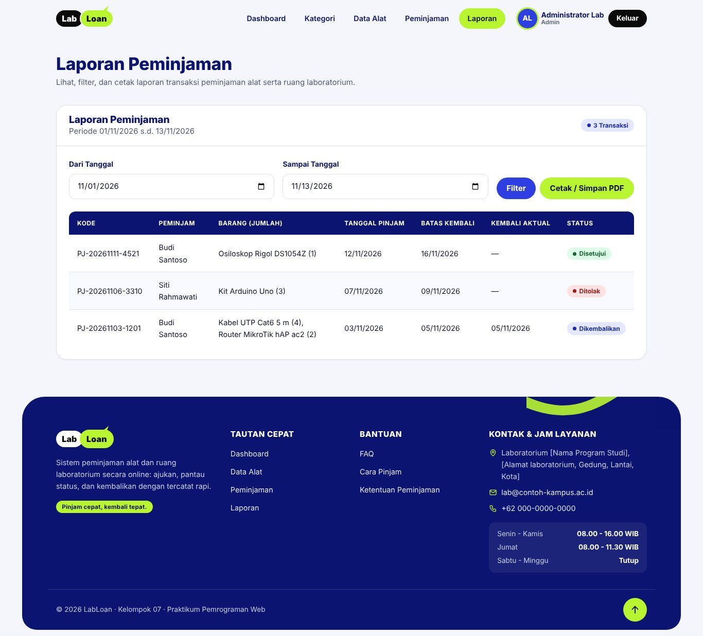 **Laporan** |
| 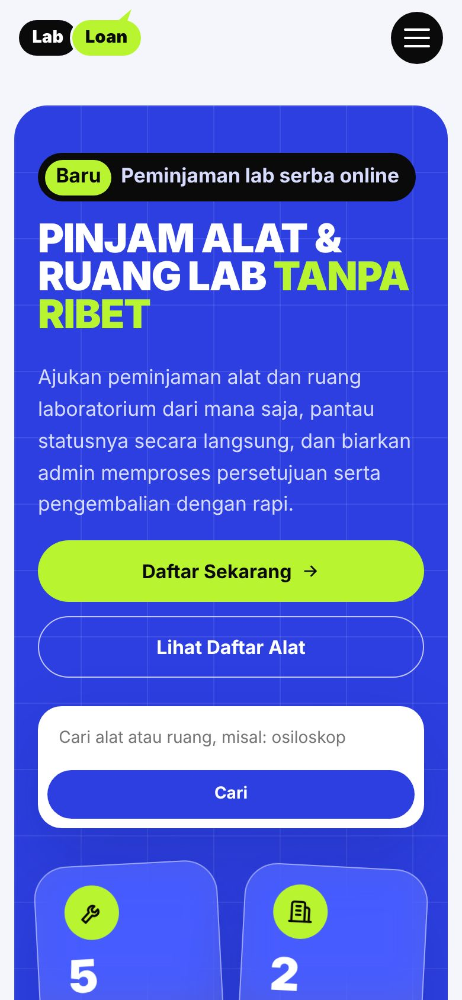 **Tampilan HP** | 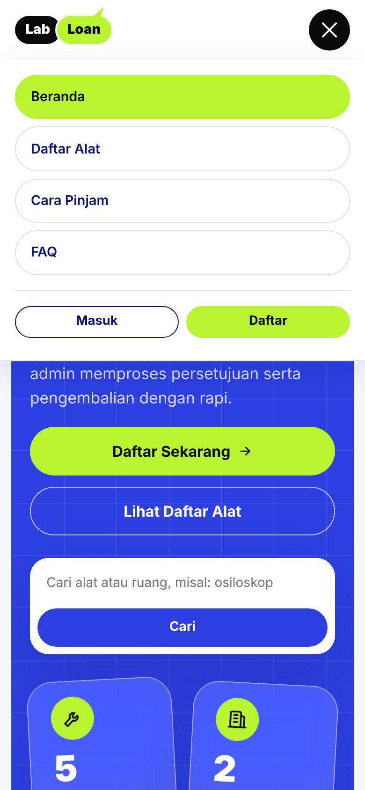 **Menu HP** |

Contoh hasil cetak laporan: [`docs/screenshots/15_cetak_laporan.pdf`](docs/screenshots/15_cetak_laporan.pdf)

---

## Konfigurasi

Data kontak dan jam layanan laboratorium yang tampil di footer dan FAQ diatur di `config/app.php`:

```php
define('LAB_NAMA', 'Laboratorium [Nama Program Studi]');
define('LAB_ALAMAT', '[Alamat laboratorium, Gedung, Lantai, Kota]');
define('LAB_EMAIL', 'lab@contoh-kampus.ac.id');
define('LAB_TELEPON', '+62 000-0000-0000');
define('LAB_JAM_OPERASIONAL', [ ... ]);
```

Zona waktu aplikasi: `Asia/Jakarta` (konstanta `APP_TIMEZONE`).

---

© 2026 LabLoan · Kelompok 07 · Praktikum Pemrograman Web
