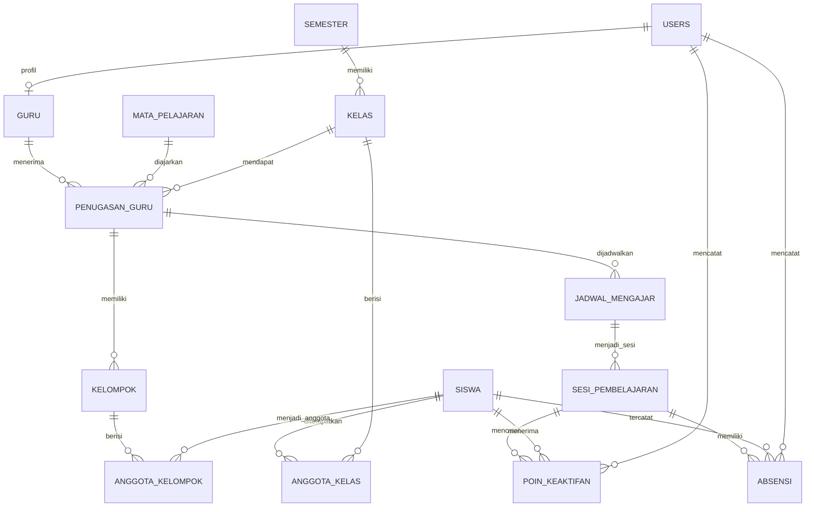

# ATTENDARA

ATTENDARA adalah aplikasi administrasi pembelajaran SMA berbasis PHP Native, PDO, dan MySQL/MariaDB. Admin mengelola data sekolah, semester, kelas, penempatan siswa, penugasan guru, dan jadwal mengajar. Guru menggunakan jadwal untuk menjalankan sesi, mencatat kehadiran melalui hitungan tap anonim, memberi poin keaktifan, serta mengatur kelompok belajar.

Siswa tidak memiliki akun. Akun hanya tersedia untuk Admin dan Guru.

## Fitur dan alur penggunaan

### Admin

1. Masuk dengan akun Admin.
2. Buat semester melalui **Semester**, lalu tetapkan semester berjalan sebagai **aktif**.
3. Kelola **Kelas**, **Siswa**, **Guru**, dan **Mata Pelajaran**. Saat menambah kelas, pilih semester yang menaunginya.
4. Buka **Penempatan Kelas**, pilih semester dan kelas, lalu tempatkan siswa. Seorang siswa hanya dapat ditempatkan pada satu kelas di semester yang sama; riwayat semester sebelumnya tetap tersimpan.
5. Buka **Penugasan Guru** untuk menghubungkan satu guru, satu mata pelajaran, dan satu kelas. Setiap kombinasi guru/mata pelajaran/kelas hanya dapat dibuat sekali. Kolom Jadwal menunjukkan jumlah jadwal yang terhubung.
6. Buka **Jadwal Mengajar** untuk membuat satu atau beberapa jadwal untuk penugasan. Pilih nama hari, jam mulai dan selesai, serta masa berlaku opsional. Hari disimpan sebagai angka internal 1–7, tetapi antarmuka menampilkan nama harinya.
7. Dashboard menampilkan ringkasan dan grafik data siswa menurut kelas aktif dan semester.

### Guru

1. Masuk dengan akun Guru yang telah dibuat Admin dan buka dashboard untuk melihat penugasan serta jadwal pada semester aktif.
2. Dari kelas/penugasan, mulai sesi pembelajaran. Saat sesi dibuat, daftar siswa kelas menjadi roster sesi dengan status awal hadir.
3. Catat tap kehadiran secara anonim. Sistem menyimpan jumlah tap, bukan identitas siswa yang mengetuk. Jika ada siswa tidak hadir, ubah statusnya menjadi izin, sakit, atau alpha.
4. Tambahkan poin keaktifan pada sesi yang sedang berlangsung dan kelola kelompok untuk penugasan.
5. Selesaikan sesi setelah jumlah tap ditambah jumlah siswa berstatus non-hadir sama dengan jumlah siswa dalam roster. Sesi yang telah selesai dapat dilihat di arsip pembelajaran.

## Instalasi lokal

### Persyaratan

- PHP 8 atau versi yang kompatibel dengan sintaks proyek, dengan ekstensi `pdo_mysql` aktif.
- MySQL 8+ atau MariaDB 10.5+.
- Laragon, atau web server PHP lain yang mendukung aplikasi PHP.

### Langkah instalasi dengan Laragon

1. Letakkan folder proyek di direktori web Laragon, misalnya `www/attendara`.
2. Jalankan Apache/Nginx dan MySQL dari Laragon.
3. Buat database kosong bernama `attendara`, atau gunakan nama database lain dan sesuaikan konfigurasinya.
4. Impor `database/attendara.sql` ke database kosong untuk membuat tabel.
5. (Opsional) Impor `database/attendara_dummy.sql` setelah skema dibuat untuk mengisi contoh data. Seed ini hanya untuk database kosong dan hanya boleh diimpor sekali.
6. Buka `http://localhost/attendara/login.php` (sesuaikan URL dengan nama folder proyek).

Koneksi memakai variabel environment PHP berikut. Untuk Laragon lokal, jika tidak diatur, host default `127.0.0.1`, database `attendara`, username `root`, dan password kosong.

| Variabel | Default | Keterangan |
| --- | --- | --- |
| `ATTENDARA_DB_HOST` | `127.0.0.1` | Host MySQL/MariaDB |
| `ATTENDARA_DB_NAME` | `attendara` | Nama database |
| `ATTENDARA_DB_USER` | `root` untuk host lokal | Username database; wajib diisi untuk host nonlokal |
| `ATTENDARA_DB_PASSWORD` | kosong | Password database |

Konfigurasi koneksi ada di [config/database.php](config/database.php). File skema menggunakan `CREATE TABLE IF NOT EXISTS`, sehingga tidak mengubah tabel lama. Untuk instalasi ulang, buat database baru/kosong; jangan impor seed ke database yang sudah berisi data.

### Akun contoh

Seed menyediakan akun berikut:

| Peran | Username | Password |
| --- | --- | --- |
| Admin | `admin` | `admin` |
| Guru | `guru1` sampai `guru5` | sama dengan username masing-masing |

Akun dan kata sandi tersebut hanya untuk pengembangan lokal. Ganti atau hapus sebelum aplikasi digunakan di lingkungan publik.

Seed contoh berisi 90 siswa (nomor induk 1000–1089), 6 kelas yang membagi siswa ke tiga kelas di masing-masing semester 2026 Genap dan Ganjil, 5 guru, 7 mata pelajaran tingkat 11, serta penugasan dan jadwal untuk semester aktif. Data sesi, absensi, kelompok, anggota kelompok, dan poin keaktifan sengaja kosong.

## Struktur database dan ERD

Skema aktual dibuat oleh [database/attendara.sql](database/attendara.sql), sedangkan contoh data berada di [database/attendara_dummy.sql](database/attendara_dummy.sql). Penjelasan atribut, aturan integritas, dan pertimbangan desain tersedia di [docs/ERD.md](docs/ERD.md).

Ringkasan relasi:

- Satu semester memiliki banyak kelas; kelas yang sama secara konseptual pada semester berbeda adalah baris kelas yang berbeda.
- Siswa terhubung ke kelas melalui `anggota_kelas`. Satu siswa hanya memiliki satu kelas per semester.
- `penugasan_guru` menghubungkan satu guru, satu mata pelajaran, dan satu kelas. Satu penugasan dapat memiliki banyak jadwal.
- Satu jadwal dapat memiliki banyak sesi. Absensi dan poin terkait pada sesi, sedangkan kelompok terkait pada penugasan.
- Hanya ada satu semester berstatus aktif pada satu waktu. Foreign key dan constraint skema menjaga relasi serta keunikan data.

## Autentikasi dan keamanan

Halaman Admin dan Guru memeriksa peran akun. Password disimpan sebagai hash dan diverifikasi dengan `password_verify`. Formulir yang mengubah data memakai token CSRF. Sesi login memiliki batas waktu tidak aktif dan batas usia maksimum; proses logout dilakukan melalui endpoint POST.

Jangan menaruh kredensial database produksi di repository. Atur melalui environment server dan gunakan akun database dengan hak minimum yang dibutuhkan.
