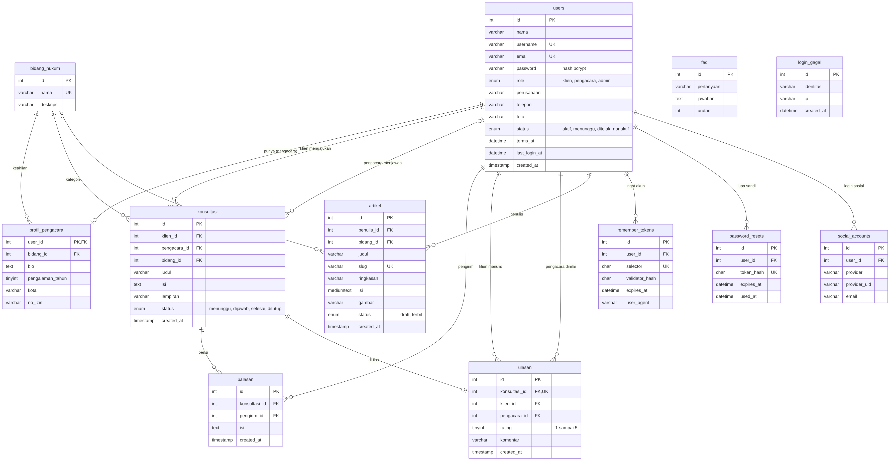
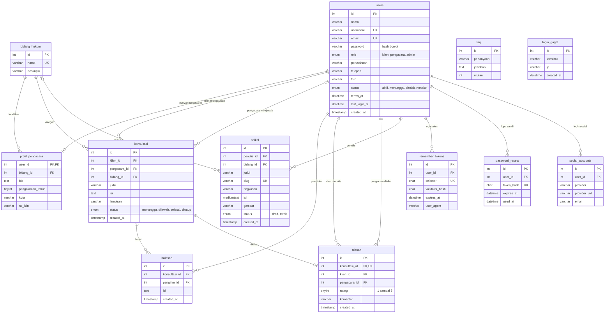

# Ruang Hukum: Konsultasi Hukum Online (Kelompok 25)

Tugas Besar Pemrograman Web 2026, Universitas Lampung. PHP native, MySQL/MariaDB, Bootstrap 5. Metode pengembangan: Waterfall.

Ruang Hukum mempertemukan **klien** dengan **pengacara** terverifikasi untuk konsultasi hukum secara tertulis. **Admin** mengelola pengguna, verifikasi pengacara, artikel, FAQ, dan bidang hukum.

## Fitur

**Pengunjung**: Beranda, direktori 50 pengacara (cari dan filter), artikel hukum, FAQ per kategori, Tentang Kami, Syarat Penggunaan.

**Masuk dan daftar** (semua data tersimpan di database)
- Masuk dengan **username atau email**, tombol mata untuk melihat kata sandi, **Ingat akun saya** (30 hari), **Lupa kata sandi** (tautan sekali pakai, berlaku 60 menit).
- Masuk atau daftar dengan **Google, LinkedIn, dan Facebook** (OAuth 2.0).
- Formulir daftar: nama lengkap, username (dicek ketersediaannya langsung), perusahaan, nomor handphone (dirapikan ke format 08...), email, kata sandi dengan meter kekuatan, konfirmasi kata sandi, dan persetujuan syarat penggunaan (waktunya disimpan).
- Pembatas percobaan salah kata sandi (5 kali per 15 menit), kata sandi disimpan sebagai hash bcrypt, perlindungan CSRF.
- Kotak profil di kanan navbar: foto profil (unggah dan hapus), login terakhir, dan tombol Keluar.

**Klien**: ajukan konsultasi, lihat riwayat, balas pengacara, tandai selesai, lalu **beri rating bintang dan ulasan** yang tampil di profil pengacara dan Beranda.

**Pengacara**: dashboard, jawab konsultasi, profil dan keahlian, lihat rating.

**Admin**: ringkasan, verifikasi pengacara, kelola pengguna, moderasi konsultasi, kelola artikel, FAQ, dan bidang hukum.

## Cara menjalankan di laptop

Butuh XAMPP atau Laragon (PHP 8.2+, MariaDB 10.4+).

1. Nyalakan **Apache** dan **MySQL**.
2. Taruh folder proyek di `htdocs` (XAMPP) atau `www` (Laragon).
3. Buka http://localhost/phpmyadmin, klik tab **SQL**, tempel seluruh isi `database/schema.sql`, klik **Go**. Ini membuat database `ruang_hukum` beserta tiga akun contoh.
4. (Disarankan) Isi data contoh: jalankan `database/data_contoh.sql` lalu `database/data_artikel_faq.sql` dengan cara yang sama. Isinya 50 pengacara, klien, konsultasi, ulasan, 10 artikel, dan 19 FAQ.
5. Buka http://localhost/TUBES_PRK_PEMWEB_2026/kelompok/kelompok_25/
6. Bila memakai MySQL dengan kata sandi, ubah `config/database.php`.

**Sudah punya database dari versi lama?** Jangan impor ulang `schema.sql` (data hilang). Cukup jalankan `database/migrasi_auth.sql` sekali di phpMyAdmin. Data lama aman.

## Akun contoh (kata sandi semua: `Admin123!`)
| Peran | Username | Email |
|---|---|---|
| Admin | `admin` | admin@ruanghukum.test |
| Klien | `budi` | klien@ruanghukum.test |
| Pengacara | `sari` | pengacara@ruanghukum.test |

## Mode demo dan login media sosial

Dua hal ini aktif secara bawaan supaya fitur bisa didemokan di laptop tanpa server email dan tanpa kunci OAuth (lihat `config/auth.php`):

- **Lupa kata sandi**: karena belum ada server email, tautan reset ditampilkan langsung di layar (kotak kuning "Mode demo").
- **Tombol Google, LinkedIn, Facebook**: selama kunci OAuth belum diisi, tombol membuka halaman **simulasi** yang berlabel jelas "Mode simulasi" (bukan Google sungguhan). Akun yang dibuat dari simulasi hanya berupa akun klien baru, dan tidak pernah menautkan ke akun yang sudah ada.

Untuk memakai Google/LinkedIn/Facebook yang **asli**, salin `config/auth.local.contoh.php` menjadi `config/auth.local.php`, isi `client_id` dan `client_secret` dari konsol penyedia, dan daftarkan alamat redirect `<alamat situs>/auth/sosial_callback.php`. File `auth.local.php` tidak ikut di-commit. Bila situs dipakai sungguhan, set `demo_tautan_reset` dan `demo_sosial` menjadi `false`.

## Struktur folder
```
kelompok_25/
├── index.php, pengacara.php, artikel*.php, faq.php, tentang.php, syarat.php   halaman publik
├── auth/        masuk, daftar, keluar, lupa/reset kata sandi, login sosial, foto profil
├── klien/       dashboard, ajukan konsultasi, detail dan balas, rating, profil
├── pengacara/   dashboard, jawab konsultasi, profil
├── admin/       dashboard, verifikasi, pengguna, konsultasi, artikel, FAQ, bidang
├── includes/    header, footer, fungsi bantu (functions.php, auth.php), komponen
├── config/      app.php, database.php, auth.php
├── assets/      css dan js
├── database/    schema.sql, migrasi_auth.sql, data_contoh.sql, data_artikel_faq.sql
└── docs/        erd.png, erd.mmd, screenshots/
```

## Database (ERD)



Diagram yang sama dalam bentuk teks (tampil otomatis di GitHub):



## Screenshot

Lihat folder [`docs/screenshots/`](docs/screenshots/).

## Tim dan modul
| Anggota | Modul |
|---|---|
| Rafi Zakwan Ekaputra (ketua) | Desain, fondasi, database, masuk dan daftar, integrasi, admin |
| Nafiza Fadhila Hasanah | Halaman publik (beranda, daftar pengacara, FAQ, tentang) |
| Aziz Muhammad Sultan Ghani | Modul klien (`klien/`) |
| Nadya Putri Gusnarni | Modul pengacara (`pengacara/`) |
| Linda Syahrun Putri | Modul admin dan artikel (`admin/`) |

Aturan desain dan kerangka halaman: lihat [DESIGN.md](DESIGN.md).
